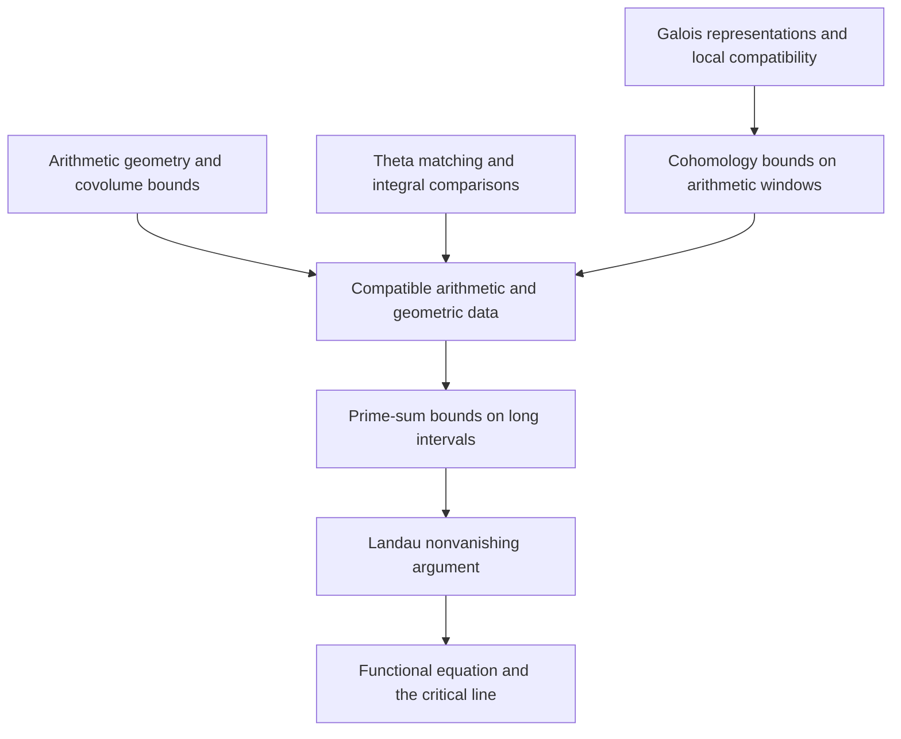

# Riemann, line by line

**A human-readable field guide to the mathematics in Levent Alpöge’s released Lean argument.**

[Read the website](https://alexisdpc.github.io/riemann/) · [Explore the proof map](https://alexisdpc.github.io/riemann/index.html#proof-map) · [Open the technical notes](https://alexisdpc.github.io/riemann/technical.html)

Created by **[Alexis Plascencia](https://alexisplascencia.com)**. The original
mathematical work is attributed to **Levent Alpöge**.

The Riemann hypothesis is easy to state and difficult to approach. This guide
starts with primes, characters, and the geometry of the critical strip, then
follows the arithmetic and analytic ingredients behind the released argument.
The emphasis is on definitions, intuition, intermediate equations, and why one
step leads to the next. Selective Lean references support the explanations.

## Find your way in

| Read | What you will find |
| --- | --- |
| [Overview](https://alexisdpc.github.io/riemann/) | The problem, an interactive reflection diagram, and a five-layer proof map. |
| [Technical notes](https://alexisdpc.github.io/riemann/technical.html) | Mathematical foundations and step-by-step arguments, from arithmetic windows to the critical line. |
| [References and sources](https://alexisdpc.github.io/riemann/sources.html#references) | A numbered bibliography with reading guidance, followed by selected declarations and source provenance. |

For a first visit, start with the overview and then read the
[final reflection argument](https://alexisdpc.github.io/riemann/technical.html#reflection).
It shows exactly why nonvanishing to the right of one half forces zeros in the
critical strip onto its middle line. The rest of the technical companion follows
the deeper inputs supplying that nonvanishing theorem.

The [reference list](https://alexisdpc.github.io/riemann/sources.html#references)
separates the released source and Mathlib from background reading in DLMF,
Milne’s *Class Field Theory*, and Mazur’s *Deforming Galois Representations*.
Each entry links to the relevant sections of the guide. The main menu on every page
also links to the companion [Yang–Mills proof guide](https://alexisdpc.github.io/yang-mills/).

## The mathematical route



The current edition explains:

- **Landau nonvanishing:** smoothed prime sums, transform residues, localized
  kernels, tail estimates, and the growth contradiction that excludes a zero.
- **Arithmetic windows:** localization kernels in Galois cohomology, logarithmic
  size bounds from nonzero congruence integers, exceptional-twist cutoffs, and
  the quantifiers needed for long intervals.
- **The prime-sum comparison:** finite character orthogonality, cancellation of
  main terms, and four normalized costs balanced by a square-root chain length.
- **Galois and local compatibility:** representations, characteristic polynomials,
  Hodge weights, local parameters, and the hypotheses on their comparisons;
  normalized cocycles, constrained deformation rings, a graded cotangent quotient,
  integral lifts and length bounds, automorphic rigidity, and trace congruences
  leading to the cohomology budget.
- **The cotangent-to-trace bound:** graded Euler characteristics with kernel
  corrections, elementary-divisor layers, an explicit monomial count, localized
  multiplicities, and the factor of two in the trace-valuation estimate.
- **Theta matching:** convergent integrals, nonzero proportionality constants,
  test vectors, periods in a common lattice, correlation bounds, and mean slopes.
- **Covolume estimates:** lattices, slopes, projection losses, and the absorption
  of exponentially small errors, with component-rank comparisons and local
  determinant jets that survive cancellation.
- **The final deduction:** an explicit small-parameter choice, passage from
  primitive to all characters, and reflection through the functional equation,
  including the explicit trivial-zero exclusions for zeta.

## Scope and verification

This is an explanatory guide to selected parts of the released source. It follows
RH and the critical-line assertions for **Dirichlet L-functions**. Deeper geometric
and automorphic construction theorems remain identified inputs where their full
proofs have not yet been explained.

Many people claim successful Lean compilation.

The complete Lean project has **not been independently built or subjected to a
final-theorem axiom audit in this repository**. The website checks described below
validate its equations, links, assets, and source excerpts. They are separate from
verification of the underlying Lean proof.

## Run locally

Requires **Node.js 18 or later**. No package installation is needed.

```sh
git clone https://github.com/alexisdpc/riemann.git
cd riemann
node scripts/serve.mjs
```

Open [localhost:4174](http://127.0.0.1:4174/). To preview the same subdirectory
layout used by GitHub Pages:

```sh
node scripts/serve.mjs --project-path
```

Then open [localhost:4174/riemann/](http://127.0.0.1:4174/riemann/).
Set the `PORT` environment variable if another port is needed.

## Check, build, and deploy

```sh
node scripts/check.mjs
node scripts/build.mjs
```

The checker validates local links and cross-page anchors, LaTeX rendering,
JavaScript syntax, math initialization, fonts, source-file hashes, and the exact
displayed Lean excerpts. The build writes a static website to `dist/`.

[The Pages workflow](.github/workflows/pages.yml) checks, builds, and deploys the
site on pushes to `main`; it can also be run manually from GitHub Actions. Only
the built `dist/` directory is uploaded to GitHub Pages. Running the build locally
does not publish anything.

## Inside the repository

| Path | Purpose |
| --- | --- |
| `index.html` | Overview, proof map, and interactive reflection diagram. |
| `technical.html` | Foundations and expanded mathematical explanations. |
| `sources.html` | Curated source index and provenance. |
| `assets/` | Styles, scripts, local fonts, and vendored KaTeX. |
| `references/lean/` | 44 unchanged Lean files supporting the explanations. |
| `references/provenance.json` | Archive identity, hashes, toolchain, and review status. |
| `scripts/` | Local server, content checks, build, and excerpt maintenance. |
| `.github/workflows/pages.yml` | Automated GitHub Pages publication. |

The original archive and full extracted tree in `alpo-proof/`, downloaded research
in `research/tao/`, and local previews are ignored by Git and excluded from the
website. **A fresh clone has everything needed to run and build the guide.**

## Extending the guide

Lead with mathematical meaning: define the objects, state the hypotheses, explain
the intuition, and show the intermediate reasoning. Keep source links selective;
avoid adding a snapshot for every dependency. Preserve the distinction between an
explained deduction, a deeper theorem used as an input, and a completed audit.

The optional `node scripts/sync-source-excerpts.mjs` command refreshes curated
excerpts from a local copy of the original archive. Its selection is recorded in
`references/nonvanishing-sources.json`; ordinary checks and builds use the committed
snapshots and do not need that archive.

The visual design adapts Alexis Plascencia’s Yang–Mills field guide. KaTeX and font
license files remain alongside their vendored assets. The Visits and Hits counters
use HitsCounter.dev and Hits.sh; they count page requests, including local preview
loads, rather than unique readers.

*First edition · 20 November 2026.*
